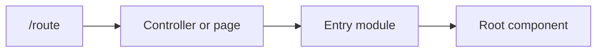
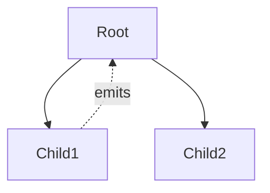
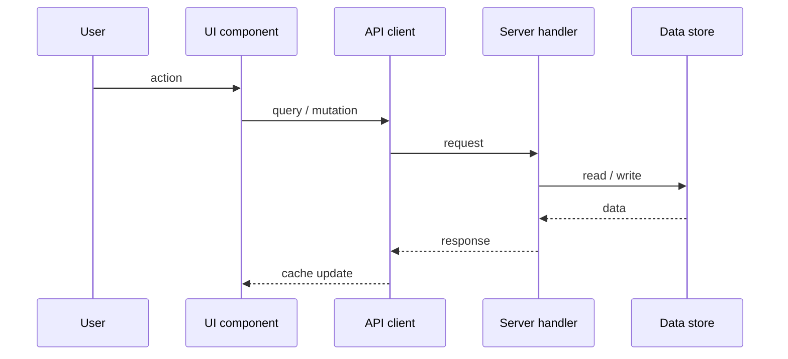

# <Feature name>

Last verified against `<branch>` `<sha>` on <YYYY-MM-DD>. Tracking item: [<reference>](url). Flag: `<flag or none>`.

## In one paragraph

What a user sees, where, and why it exists.

## Page map

## Component tree

## Data flow

## Files

| Role | Path | Notes |
| --- | --- | --- |

## Flags and permissions

## Tests

| Layer | Path | Covers |
| --- | --- | --- |

## History (change trail)

## Open follow-ups

## Gotchas
